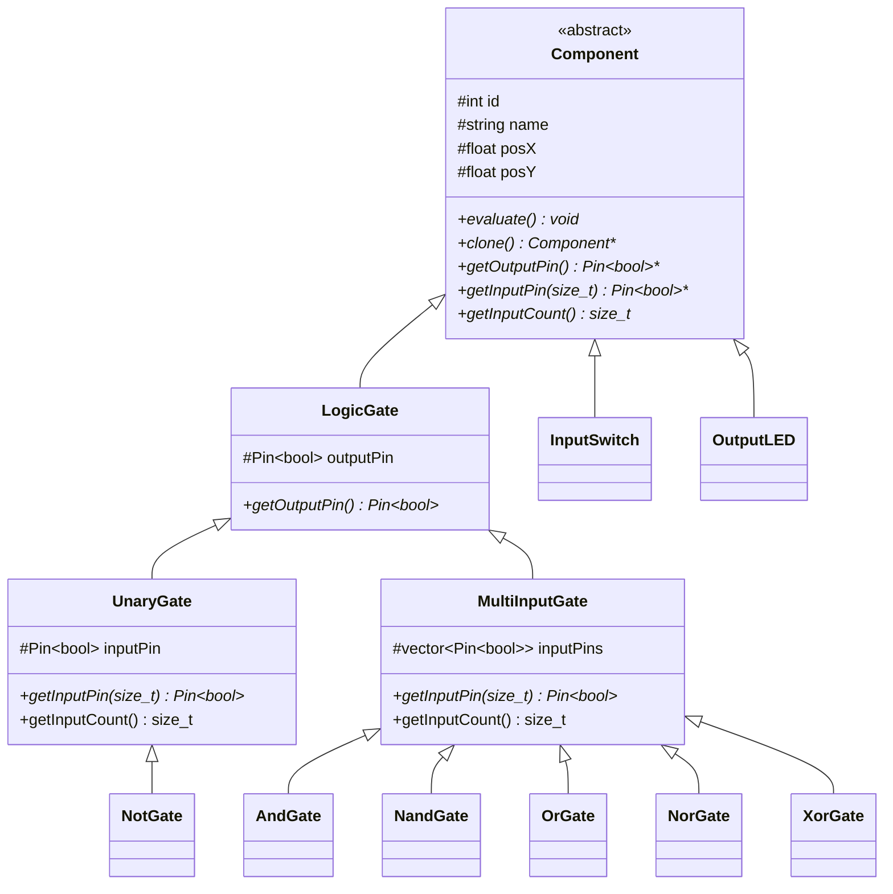

# Simulador de Portas Lógicas (Logic Gate Simulator)

Simulador de circuitos digitais combinacionais desenvolvido em **C++17**, contando com um núcleo de simulação orientado a objetos (executável via terminal/CLI) e uma interface gráfica interativa construída com **SFML 3**.

---

## Sumário

- [Visão Geral e Funcionalidades](#-visão-geral-e-funcionalidades)
- [Componentes e Portas Lógicas](#-componentes-e-portas-lógicas)
  - [Funcionamento Detalhado do Gate NOR (`NorGate`)](#funcionamento-detalhado-do-gate-nor-norgate)
- [Arquitetura do Projeto](#-arquitetura-do-projeto)
- [Estrutura de Diretórios](#-estrutura-de-diretórios)
- [Pré-requisitos](#-pré-requisitos)
- [Como Compilar e Executar](#-como-compilar-e-executar)
  - [1. Usando Makefile](#1-usando-makefile)
  - [2. Usando CMake](#2-usando-cmake)
  - [3. Usando VS Code](#3-usando-vs-code)
  - [4. Compilação Manual com `g++`](#4-compilação-manual-com-g)
- [Controles da Interface Gráfica (GUI)](#-controles-da-interface-gráfica-gui)

---

## Visão Geral e Funcionalidades

- **Motor de Simulação Digital (`logic_core`)**:
  - Avaliação iterativa de componentes e propagação de sinais através de trilhas (`Wire`) até a estabilização do circuito (`CircuitBoard::stepSimulation()`).
  - Suporte a portas lógicas de **1 entrada** (`NOT`) e de **2 ou 3 entradas** (`AND`, `NAND`, `OR`, `NOR`, `XOR`).
  - Componentes de entrada (`InputSwitch`) e saída visual (`OutputLED`).
  - **Gerenciamento dinâmico de memória e Regra dos Três**: `CircuitBoard` implementa construtor de cópia, operador de atribuição por cópia e destrutor utilizando alocação dinâmica (`Component**` e `Wire**`) e clonagem polimórfica (`Component::clone()`) para *deep copy* completo e isolamento de memória.
  - **Programação Genérica (Templates)**: classe `Pin<T>` parametrizada por tipo de sinal, função template `growArray<T>()` para redimensionamento de arrays dinâmicos e método fábrica `CircuitBoard::createComponent<T>()`.
- **Interface Gráfica Interativa (`simulador_gui`)**:
  - Construção visual de circuitos com adição de portas, chaves (`SWITCH`) e indicadores (`LED`) pela barra lateral.
  - Seleção dinâmica entre **2 ou 3 entradas** para novas portas multi-entrada.
  - Conexão de pinos (Saída $\rightarrow$ Entrada) com visualização de fio fantasma e traçado ortogonal automático.
  - Cores dinâmicas em tempo real indicando nível lógico alto (`1 / HIGH` em verde) e nível lógico baixo (`0 / LOW` em cinza).
  - Arraste de componentes (*drag-and-drop*), alternância de chaves com clique simples e remoção rápida de fios, conexões ou componentes com o botão direito ou modo `EXCLUIR`.
  - Captura de tela automatizada via linha de comando (`--snapshot <arquivo.png>`).

---

## Componentes e Portas Lógicas

| Componente | Classe | Entradas | Saída | Descrição Lógica |
| :--- | :--- | :---: | :---: | :--- |
| **NOT** | `NotGate` | 1 | 1 | Inversor lógico: saída é `1` se e somente se a entrada for `0` ($Y = \overline{A}$). |
| **AND** | `AndGate` | 2 ou 3 | 1 | Conjunção: saída é `1` somente se **todas** as entradas forem `1` ($Y = A \cdot B$). |
| **NAND** | `NandGate` | 2 ou 3 | 1 | Conjunção negada: saída é `0` somente se **todas** as entradas forem `1` ($Y = \overline{A \cdot B}$). |
| **OR** | `OrGate` | 2 ou 3 | 1 | Disjunção: saída é `1` se **ao menos uma** entrada for `1` ($Y = A + B$). |
| **NOR** | `NorGate` | 2 ou 3 | 1 | Disjunção negada: saída é `1` somente se **todas** as entradas forem `0` ($Y = \overline{A + B}$). |
| **XOR** | `XorGate` | 2 ou 3 | 1 | Ou-exclusivo (paridade ímpar): saída é `1` se uma quantidade **ímpar** de entradas for `1` ($Y = A \oplus B$). |
| **SWITCH** | `InputSwitch` | 0 | 1 | Chave de entrada manual alternável entre `0 (LOW)` e `1 (HIGH)`. |
| **LED** | `OutputLED` | 1 | 0 | Indicador luminoso de saída: acende quando a entrada recebe `1 (HIGH)`. |

### Funcionamento Detalhado do Gate NOR (`NorGate`)

A classe `NorGate` (definida em `include/Gates.h` e implementada em `src/Gates.cpp`) herda de `MultiInputGate` e implementa a porta lógica **NOR** (*NOT-OR*) para **2 ou 3 entradas**:

```cpp
NorGate::NorGate(int compId, size_t numInputs, float x, float y)
    : MultiInputGate(compId, "NOR_" + std::to_string(numInputs), numInputs, x, y) {}

void NorGate::evaluate() {
    bool result = false;
    for (const auto& pin : inputPins) result = result || pin.getState();
    outputPin.setState(!result);
}
```

1. **Validação de Entradas**: Ao ser instanciada, `MultiInputGate` valida que `numInputs` seja estritamente `2` ou `3` (lançando `std::invalid_argument` caso contrário) e inicializa todos os pinos de entrada em `false` (`0`). O componente recebe automaticamente o nome `"NOR_2"` ou `"NOR_3"`.
2. **Avaliação Lógica (`evaluate()`)**:
   - Acumula a operação `OR` (`||`) entre todos os pinos de entrada (`inputPins`).
   - Inverte o resultado final (`!result`) e grava no pino de saída (`outputPin`).
   - Assim, a saída só assume nível alto (`1`) quando **todas** as entradas estão em nível baixo (`0`). Qualquer entrada em `1` força a saída para `0`.
3. **Comportamento de Pinos Desconectados**:
   - Pinos de entrada sem fio conectado permanecem em estado lógico `false` (`0`, equivalente a *pull-down*). Ao desconectar um fio (`Wire::disconnectInputPin()`), o pino de entrada volta automaticamente para `0`.
   - Portanto, uma porta `NOR` recém-inserida na placa (com todas as entradas em `0`) apresenta saída `1 (HIGH)` imediatamente após o ciclo de simulação.

#### Tabela-Verdade — `NOR_2` (2 entradas)

| Entrada $A$ (Pino 0) | Entrada $B$ (Pino 1) | Saída $Y = \overline{A + B}$ |
| :---: | :---: | :---: |
| `0` | `0` | **`1`** |
| `0` | `1` | **`0`** |
| `1` | `0` | **`0`** |
| `1` | `1` | **`0`** |

#### Tabela-Verdade — `NOR_3` (3 entradas)

| Entrada $A$ | Entrada $B$ | Entrada $C$ | Saída $Y = \overline{A + B + C}$ |
| :---: | :---: | :---: | :---: |
| `0` | `0` | `0` | **`1`** |
| Qualquer combinação com ao menos um `1` | — | — | **`0`** |

---

## Arquitetura do Projeto



---

## Estrutura de Diretórios

```text
LOGIC GATE SIMULATOR/
├── assets/
│   └── fonts/
│       ├── DejaVuSans.ttf          # Fonte utilizada na interface gráfica
│       └── LICENSE-DejaVu.txt
├── build/                          # Binários compilados (simulador / simulador_gui)
├── include/
│   ├── CircuitBoard.h              # Placa de circuito, gerenciamento de memória e simulação
│   ├── Component.h                 # Classe base abstrata dos componentes
│   ├── Gates.h                     # Portas lógicas (NOT, AND, NAND, OR, NOR, XOR), Switch e LED
│   ├── Pin.h                       # Template Pin<T> para terminais de entrada e saída
│   ├── Wire.h                      # Conexão lógica entre um pino de saída e um de entrada
│   └── gui/
│       ├── GuiApplication.h        # Controlador principal da janela e eventos SFML
│       ├── GuiRenderer.h           # Renderização de portas, pinos, grade e fios ortogonais
│       └── Sidebar.h               # Barra lateral de ferramentas da GUI
├── src/
│   ├── CircuitBoard.cpp
│   ├── Component.cpp
│   ├── Gates.cpp
│   ├── Wire.cpp
│   ├── main.cpp                    # Ponto de entrada da demonstração em terminal (CLI)
│   └── gui/
│       ├── GuiApplication.cpp
│       ├── GuiRenderer.cpp
│       ├── Sidebar.cpp
│       └── main_gui.cpp            # Ponto de entrada da aplicação gráfica (SFML 3)
├── CMakeLists.txt                  # Configuração de build para CMake
└── Makefile                        # Automação de compilação via Make / g++
```

---

## Pré-requisitos

- **Compilador C++** com suporte a **C++17** (`g++`, `clang++` ou `MSVC`).
- **SFML 3** (`sfml-graphics`, `sfml-window`, `sfml-system`) — necessário apenas para compilar a versão gráfica (`simulador_gui`). No Windows com MSYS2/UCRT64, pode ser instalado via `pacman -S mingw-w64-ucrt-x86_64-sfml`.
- **CMake 3.16+** ou **GNU Make** (opcional).

---

## Como Compilar e Executar

Execute os programas sempre a partir da **raiz do projeto** para que a interface gráfica localize corretamente a fonte em `assets/fonts/DejaVuSans.ttf`.

### 1. Usando Makefile

```bash
# Compilar versão CLI e GUI
make all

# Compilar e executar apenas a versão de terminal (CLI)
make run

# Compilar e executar a interface gráfica (GUI)
make run-gui

# Limpar binários gerados
make clean
```

### 2. Usando CMake

```bash
cmake -B build
cmake --build build

# Executar CLI
./build/simulador

# Executar GUI (compilado automaticamente se o SFML 3 for encontrado)
./build/simulador_gui
```

### 3. Usando VS Code

O projeto já inclui configurações prontas em `.vscode/tasks.json` e `.vscode/launch.json`:
- **Build GUI (SFML 3)**: compila `build/simulador_gui.exe`.
- **Build Core (Terminal)**: compila `build/simulador.exe`.
- **Play / Debug Active File**: permite compilar e executar diretamente pelo botão *Play* tanto `src/main.cpp` quanto `src/gui/main_gui.cpp` (suporte a *unity build* quando `MULTI_FILE_BUILD` não está definido).

### 4. Compilação Manual com `g++`

**Versão Terminal (CLI):**
```bash
g++ -std=c++17 -Wall -Wextra -Wpedantic -Iinclude -DMULTI_FILE_BUILD \
    src/Component.cpp src/Wire.cpp src/Gates.cpp src/CircuitBoard.cpp src/main.cpp \
    -o build/simulador
```

**Versão Gráfica (GUI com SFML 3):**
```bash
g++ -std=c++17 -Wall -Wextra -Wpedantic -Iinclude -DMULTI_FILE_BUILD \
    src/Component.cpp src/Wire.cpp src/Gates.cpp src/CircuitBoard.cpp \
    src/gui/GuiRenderer.cpp src/gui/Sidebar.cpp src/gui/GuiApplication.cpp src/gui/main_gui.cpp \
    -o build/simulador_gui -lsfml-graphics -lsfml-window -lsfml-system
```

---

## Controles da Interface Gráfica (GUI)

| Ação | Controle |
| :--- | :--- |
| **Adicionar componente** | Clique no botão correspondente na barra lateral esquerda (`AND`, `NAND`, `OR`, `NOR`, `XOR`, `NOT`, `SWITCH`, `LED`). |
| **Configurar nº de entradas** | Selecione **`2`** ou **`3`** na seção *Entradas (AND..XOR)* antes de criar a porta lógica. |
| **Mover componente** | Clique com o botão esquerdo sobre o corpo do componente e arraste. |
| **Alternar estado de um `SWITCH`** | Clique simples com o botão esquerdo sobre o `SWITCH` (sem arrastar). |
| **Conectar componentes (Criar fio)** | Clique no **pino de saída** (lado direito) do componente de origem e, em seguida, clique no **pino de entrada** (lado esquerdo) do componente de destino. |
| **Cancelar criação de fio** | Pressione `ESC` ou clique com o **botão direito** do mouse. |
| **Remover fio / desconectar pino** | Clique com o **botão direito** diretamente sobre o fio ou sobre o pino conectado (ou use o botão `EXCLUIR (ON)`). |
| **Excluir componente** | Clique com o **botão direito** sobre o corpo do componente (ou clique nele com `EXCLUIR (ON)` ativo). |
| **Limpar toda a placa** | Clique em **`LIMPAR PLACA`** na barra lateral. |
| **Salvar captura de tela (CLI)** | Execute `./build/simulador_gui --snapshot caminho/imagem.png`. |
