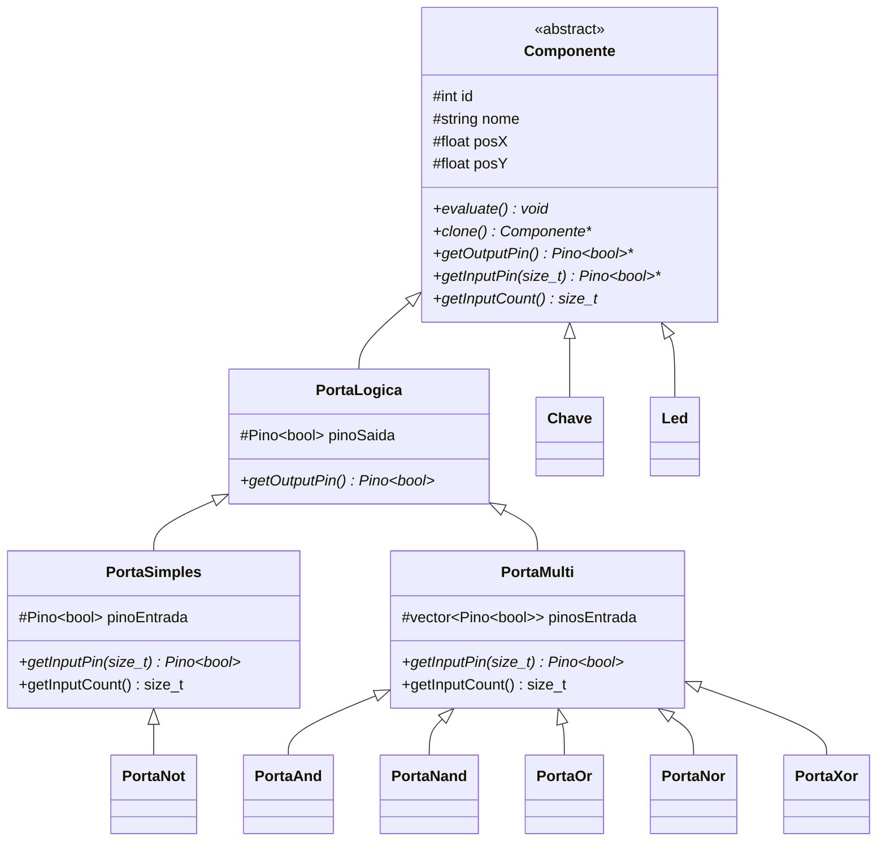

# Simulador de Portas Lógicas (Logic Gate Simulator)

Esse é o nosso simulador de circuitos digitais combinacionais feito em **C++17** para o trabalho final de **Programação III**. Ele tem um núcleo de simulação orientado a objetos (que roda direto no terminal) e uma interface gráfica interativa construída com **SFML 3** pra montar e testar os circuitos na tela.

---

## Sumário

- [O que o projeto faz](#-o-que-o-projeto-faz)
- [Componentes e Portas Lógicas](#-componentes-e-portas-lógicas)
  - [Como funciona a porta NOR (`PortaNor`)](#como-funciona-a-porta-nor-portanor)
- [Arquitetura do Projeto](#-arquitetura-do-projeto)
- [Estrutura de Pastas](#-estrutura-de-pastas)
- [O que você precisa ter instalado](#-o-que-você-precisa-ter-instalado)
- [Como compilar e rodar](#-como-compilar-e-rodar)
  - [1. Usando Makefile](#1-usando-makefile)
  - [2. Usando CMake](#2-usando-cmake)
  - [3. Usando o VS Code](#3-usando-o-vs-code)
  - [4. Na mão com `g++`](#4-na-mão-com-g)
- [Controles da Interface Gráfica (GUI)](#-controles-da-interface-gráfica-gui)

---

## O que o projeto faz

- **Núcleo de Simulação (`logic_core`)**:
  - Vai avaliando os componentes e propagando os sinais pelos fios (`Fio`) em loop até o circuito todo estabilizar (`Placa::stepSimulation()`).
  - Suporta portas lógicas de **1 entrada** (`NOT`) e de **2 ou 3 entradas** (`AND`, `NAND`, `OR`, `NOR`, `XOR`).
  - Tem chaves de entrada (`Chave`) e LEDs de saída (`Led`).
  - **Memória na mão e Regra dos Três**: a classe `Placa` implementa construtor de cópia, `operator=` e destrutor usando alocação dinâmica (`Componente** listaComp` e `Fio** listaFios`) junto com `Componente::clone()` pra fazer *deep copy* de verdade, sem vazar memória nem misturar ponteiros.
  - **Templates**: usamos a classe `Pino<T>` parametrizada pelo tipo do sinal, a função `aumentarArray<T>()` pra dobrar os arrays dinâmicos quando enchem e o método fábrica `Placa::createComponent<T>()` pra criar componentes direto na placa.
- **Interface Gráfica (`simulador_gui`)**:
  - Barra lateral (`BarraLateral`) pra ir jogando portas lógicas, chaves (`SWITCH`) e `LED`s na placa, renderizada pelo `Desenhista` dentro da `JanelaApp`.
  - Dá pra escolher se a próxima porta vai ter **2 ou 3 entradas**.
  - Ligação de pinos (Saída $\rightarrow$ Entrada) mostrando um fio guia amarelo e desenhando curvas em $90^\circ$ automaticamente.
  - Cores em tempo real: **verde** quando o sinal está em `1 (HIGH)` e **cinza** quando está em `0 (LOW)`.
  - Dá pra arrastar os componentes pela grade, clicar na chave pra ligar/desligar e apagar fios ou portas com o botão direito (ou ativando o modo `EXCLUIR`).
  - Dá até pra tirar print da tela direto pelo terminal com `--snapshot <arquivo.png>`.

---

## Componentes e Portas Lógicas

| Componente | Classe | Entradas | Saída | Como funciona |
| :--- | :--- | :---: | :---: | :--- |
| **NOT** | `PortaNot` | 1 | 1 | Inverte o sinal: sai `1` só se entrar `0` ($Y = \overline{A}$). |
| **AND** | `PortaAnd` | 2 ou 3 | 1 | Sai `1` só se **todas** as entradas forem `1` ($Y = A \cdot B$). |
| **NAND** | `PortaNand` | 2 ou 3 | 1 | O oposto da AND: sai `0` só se **todas** forem `1` ($Y = \overline{A \cdot B}$). |
| **OR** | `PortaOr` | 2 ou 3 | 1 | Sai `1` se **pelo menos uma** entrada for `1` ($Y = A + B$). |
| **NOR** | `PortaNor` | 2 ou 3 | 1 | O oposto da OR: sai `1` só quando **todas** as entradas forem `0` ($Y = \overline{A + B}$). |
| **XOR** | `PortaXor` | 2 ou 3 | 1 | Sai `1` quando tiver uma quantidade **ímpar** de entradas em `1` ($Y = A \oplus B$). |
| **SWITCH** | `Chave` | 0 | 1 | Chave manual que você clica pra alternar entre `0 (LOW)` e `1 (HIGH)`. |
| **LED** | `Led` | 1 | 0 | Luzinha de saída: acende quando recebe `1 (HIGH)`. |

### Como funciona a porta NOR (`PortaNor`)

A classe `PortaNor` (em `include/Gates.h` e `src/Gates.cpp`) herda de `PortaMulti` e implementa a lógica **NOR** (*NOT-OR*) para **2 ou 3 entradas**:

```cpp
PortaNor::PortaNor(int compId, size_t qtdEntradas, float x, float y)
    : PortaMulti(compId, "NOR_" + std::to_string(qtdEntradas), qtdEntradas, x, y) {}

void PortaNor::evaluate() {
    bool res = false;
    for (const auto& p : pinosEntrada) res = res || p.getState();
    pinoSaida.setState(!res);
}
```

1. **Validação das entradas**: quando é criada, `PortaMulti` garante que `qtdEntradas` seja `2` ou `3` (se passar outro valor, lança `std::invalid_argument`) e já começa todos os pinos em `false` (`0`). O nome fica automaticamente `"NOR_2"` ou `"NOR_3"`.
2. **Cálculo lógico (`evaluate()`)**:
   - Faz um `OR` (`||`) passando por todos os pinos de entrada (`pinosEntrada`).
   - Inverte o resultado (`!res`) e joga no pino de saída (`pinoSaida`).
   - Ou seja, a saída só fica em `1` se **todas** as entradas estiverem em `0`. Se qualquer entrada for `1`, a saída cai pra `0`.
3. **E se o pino estiver desconectado?**:
   - Pinos sem fio ligado ficam em `false` (`0`, tipo um *pull-down*). Se você apagar um fio (`Fio::disconnectInputPin()`), a entrada volta pra `0` na hora.
   - Por isso, assim que você coloca uma porta `NOR` vazia na placa (com tudo em `0`), a saída dela já acende em `1 (HIGH)`!

#### Tabela-Verdade — `NOR_2` (2 entradas)

| Entrada $A$ (Pino 0) | Entrada $B$ (Pino 1) | Saída $Y = \overline{A + B}$ |
| :---: | :---: | :---: |
| `0` | `0` | **`1`** |
| `0` | `1` | **`0`** |
| `1` | `0` | **`0`** |
| `1` | `1` | **`0`** |

#### Tabela-Verdade — `NOR_3` (3 entradas)

| Entrada $A$ | Entrada $B$ | Entrada $C$ | Saída $Y = \overline{A + B + C}$ |
| :---: | :---: | :---: | :---: |
| `0` | `0` | `0` | **`1`** |
| Qualquer combinação com pelo menos um `1` | — | — | **`0`** |

---

## Arquitetura do Projeto



---

## Estrutura de Pastas

```text
LOGIC GATE SIMULATOR/
├── assets/
│   └── fonts/
│       ├── DejaVuSans.ttf          # Fonte usada nos textos da interface gráfica
│       └── LICENSE-DejaVu.txt
├── build/                          # Onde caem os executáveis (simulador / simulador_gui)
├── include/
│   ├── CircuitBoard.h              # Classe Placa: controle de memória e simulação
│   ├── Component.h                 # Classe base abstrata Componente
│   ├── Gates.h                     # Portas (PortaNot, PortaAnd, PortaNand, PortaOr, PortaNor, PortaXor), Chave e Led
│   ├── Pin.h                       # Template Pino<T> pros terminais de entrada e saída
│   ├── Wire.h                      # Classe Fio que liga uma saída a uma entrada
│   └── gui/
│       ├── GuiApplication.h        # Classe JanelaApp: janela principal e eventos do SFML
│       ├── GuiRenderer.h           # Classe Desenhista: desenha portas, pinos, grade e fios ortogonais
│       └── Sidebar.h               # Classe BarraLateral: botões da interface
├── src/
│   ├── CircuitBoard.cpp
│   ├── Component.cpp
│   ├── Gates.cpp
│   ├── Wire.cpp
│   ├── main.cpp                    # Demo que roda direto no terminal (CLI)
│   └── gui/
│       ├── GuiApplication.cpp
│       ├── GuiRenderer.cpp
│       ├── Sidebar.cpp
│       └── main_gui.cpp            # Ponto de entrada da interface gráfica (SFML 3)
├── CMakeLists.txt                  # Configuração do CMake
└── Makefile                        # Atalhos pra compilar rápido via Make / g++
```

---

## O que você precisa ter instalado

- **Compilador C++** com suporte a **C++17** (`g++`, `clang++` ou `MSVC`).
- **SFML 3** (`sfml-graphics`, `sfml-window`, `sfml-system`) — só precisa dele se for compilar a parte gráfica (`simulador_gui`). No Windows usando MSYS2/UCRT64, é só rodar `pacman -S mingw-w64-ucrt-x86_64-sfml`.
- **CMake 3.16+** ou **GNU Make** (opcional, mas facilita bastante).

---

## Como compilar e rodar

Rode os comandos sempre a partir da **pasta raiz do projeto** pra interface conseguir achar a fonte certinha em `assets/fonts/DejaVuSans.ttf`.

### 1. Usando Makefile

```bash
# Compila o terminal (CLI) e a interface gráfica (GUI)
make all

# Compila e já roda só a versão de terminal (CLI)
make run

# Compila e já abre a interface gráfica (GUI)
make run-gui

# Apaga os executáveis gerados
make clean
```

### 2. Usando CMake

```bash
cmake -B build
cmake --build build

# Rodar no terminal (CLI)
./build/simulador

# Abrir interface gráfica (compila sozinho se achar o SFML 3)
./build/simulador_gui
```

### 3. Usando o VS Code

Já deixamos tudo configurado em `.vscode/tasks.json` e `.vscode/launch.json`:
- **Build GUI (SFML 3)**: gera `build/simulador_gui.exe`.
- **Build Core (Terminal)**: gera `build/simulador.exe`.
- **Play / Debug Active File**: dá pra compilar e rodar direto pelo botão *Play* tanto no `src/main.cpp` quanto no `src/gui/main_gui.cpp` (com suporte a *unity build* quando `MULTI_FILE_BUILD` não estiver definido).

### 4. Na mão com `g++`

**Versão Terminal (CLI):**
```bash
g++ -std=c++17 -Wall -Wextra -Wpedantic -Iinclude -DMULTI_FILE_BUILD \
    src/Component.cpp src/Wire.cpp src/Gates.cpp src/CircuitBoard.cpp src/main.cpp \
    -o build/simulador
```

**Versão Gráfica (GUI com SFML 3):**
```bash
g++ -std=c++17 -Wall -Wextra -Wpedantic -Iinclude -DMULTI_FILE_BUILD \
    src/Component.cpp src/Wire.cpp src/Gates.cpp src/CircuitBoard.cpp \
    src/gui/GuiRenderer.cpp src/gui/Sidebar.cpp src/gui/GuiApplication.cpp src/gui/main_gui.cpp \
    -o build/simulador_gui -lsfml-graphics -lsfml-window -lsfml-system
```

---

## Controles da Interface Gráfica (GUI)

| O que você quer fazer | Como faz |
| :--- | :--- |
| **Colocar um componente** | Clica no botão dele na barra da esquerda (`AND`, `NAND`, `OR`, `NOR`, `XOR`, `NOT`, `SWITCH`, `LED`). |
| **Escolher 2 ou 3 entradas** | Clica em **`2`** ou **`3`** ali em *Entradas (AND..XOR)* antes de adicionar a porta. |
| **Mover um componente** | Segura o botão esquerdo em cima dele e arrasta. |
| **Ligar/desligar um `SWITCH`** | Dá um clique rápido com o botão esquerdo no `SWITCH` (sem arrastar). |
| **Puxar um fio** | Clica no **pino de saída** (bolinha da direita) de um componente e depois clica no **pino de entrada** (bolinha da esquerda) de outro. |
| **Cancelar fio no meio do caminho** | Aperta `ESC` ou clica com o **botão direito**. |
| **Apagar um fio ou desconectar pino** | Clica com o **botão direito** direto no fio ou no pino ligado (ou ativa o modo `EXCLUIR (ON)`). |
| **Apagar um componente** | Clica com o **botão direito** no corpo dele (ou com o botão esquerdo se `EXCLUIR (ON)` estiver ativo). |
| **Limpar tudo** | Clica em **`LIMPAR PLACA`** na barra lateral. |
| **Tirar print pelo terminal** | Roda `./build/simulador_gui --snapshot caminho/imagem.png`. |
